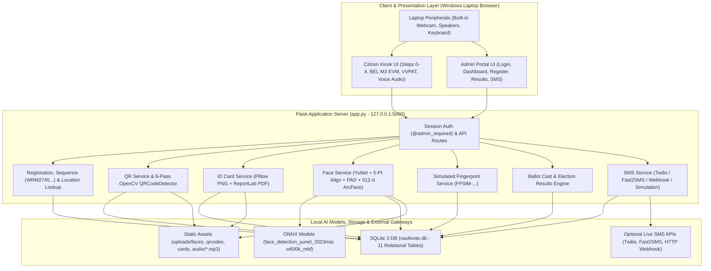
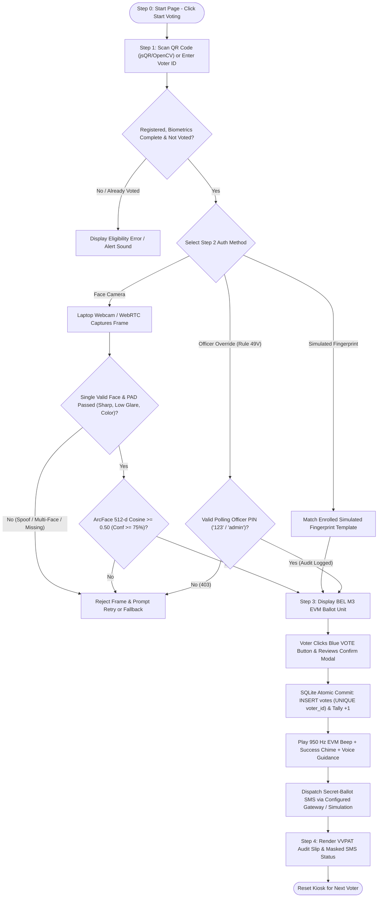
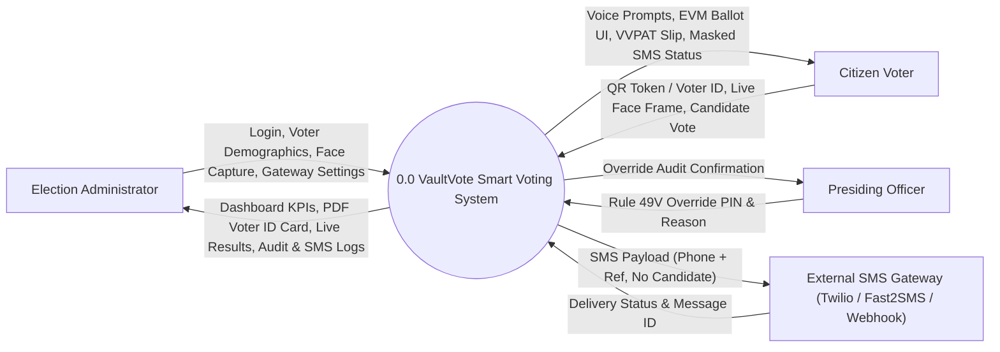
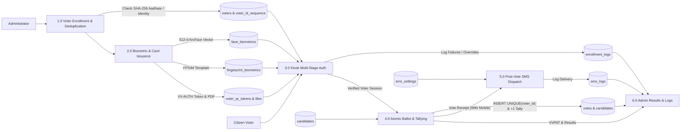
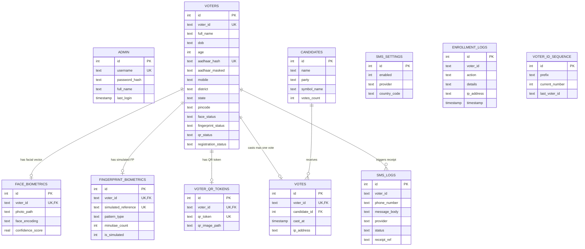
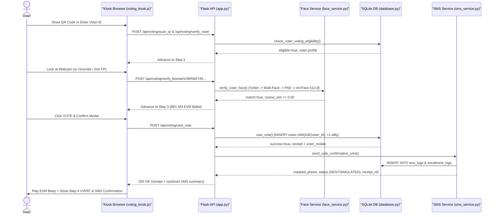

# Comprehensive Audit & Correction Report — Phase 1 Project Report vs. Actual VaultVote Implementation

**Project Title in PDF:** *Secure Smart Voting Machine with Dual Biometric Authentication (A Project Report - Phase 1)*  
**Actual Codebase Analyzed:** `D:\My Place\MiniProject\ValutVote` (**VaultVote – Smart Biometric Voting System**)  
**PDF Reviewed:** All **45 pages** (Cover pages, Front Matter `i–ii` / `i–vi`, Chapters 1–4, and References `[1]–[25]`)  
**Audit Ground Truth:** Actual source files (`app.py`, `config.py`, `database.py`, `face_service.py`, `fingerprint_service.py`, `qr_service.py`, `id_card_service.py`, `location_service.py`, `sequence.py`, `sms_service.py`, `generate_announcements.py`, `migrate_to_arcface.py`, `test_suite.py`, `requirements.txt`, `templates/`, `static/`, `models/`).

> **Executive Finding:** The existing 45-page Phase 1 PDF describes a **conceptual Raspberry Pi / IoT / Ethereum Blockchain / Solidity Smart Contract / AES-256 / Dlib / Blink-Liveness / AI-Anomaly-Monitoring** proposal and includes screenshots (`http://127.0.0.1:8000`) and fabricated test claims (50 live Twilio SMS confirmations verified on Ganache block explorer) that **do not match the actual implemented VaultVote codebase** (`http://127.0.0.1:5000`, Windows Laptop-Only Python + Flask + SQLite 3 + OpenCV YuNet + ONNX Runtime 512-d ArcFace MobileFaceNet + Passive PAD + Software-Simulated Fingerprint + ReportLab/Pillow PVC Voter ID Card + ECI M3 EVM Kiosk + Voice Guidance + Live Election Results + Multi-Gateway SMS). Major technical rewriting, front-matter pagination repair, diagram replacement, and removal of unsupported claims are required before submission.

---

## 1. Report Accuracy Verification

| Report Section | Status | Alignment Summary Against Actual Codebase |
|---|---|---|
| **Cover / Title Pages (PDF p.1–2)** | **Incorrect / Duplicate** | Duplicate title pages; typos (`DUALBIOMETRIC`, `AUTONOMUS`); omits system name (**VaultVote**) and misstates dual biometric scope compared to actual implementation. |
| **Bonafide Certificate (PDF p.3)** | **Formatting / Name Error** | Missing initial `R` on `NALINI R`; `VIVA –VOICE` typo; college crest overlaps header text; Roman page numbering breaks right after (`i, ii` followed by reset `i` on Abstract). |
| **Acknowledgement (PDF p.4)** | **Minor Error** | Stray period at bottom; Roman page number `ii` disagrees with Table of Contents (`iv`). |
| **Abstract (PDF p.5)** | **Factually Incorrect** | Claims unimplemented Blockchain, Solidity, AES-256, blinking/head-movement liveness, and AI suspicious activity monitoring; uses future proposal tense; omits YuNet, ArcFace, Simulated Fingerprint, SQLite, PVC ID Card PDF, Voice Guidance, Results, and Officer Override. |
| **List of Abbreviations (PDF p.6)** | **Outdated / Incomplete** | Lists unused `AES-256`, `AI`, `CSI`, `IoT`; omits actual `ArcFace`, `BEL`, `ECI`, `EPIC`, `HUD`, `ONNX`, `PAD`, `PDF`, `PVC`, `SQLite`, `TTS`, `VVPAT`, `YuNet`. |
| **List of Figures (PDF p.7)** | **Incomplete / Mismatched** | Calls Fig. 3.2 `DATA FLOW DIAGRAM` (caption on p.26 says `Overall Workflow`); Figs. 4.1–4.3 show an unrelated prototype on port `8000`; misses Admin, Registration, Biometric, ID Card, Results, and SMS screens. |
| **List of Tables (PDF p.8)** | **Minor Errors** | `COMPARISION` spelling typo; misses tables for 11 actual SQLite tables, Biometric thresholds/models, API endpoints, and 18 `unittest` cases. |
| **Table of Contents (PDF p.9–10)** | **Broken / Typos** | Typos (`TABLE OF CONTENT`, `ACKNOLOGNMENT`, `ABBREVATIONS`, `METHOLOGY`, `COMPARISION`); wrong front-matter Roman page numbers (`iii–ix` do not match actual pages); lacks dedicated Testing/Results chapter. |
| **Introduction (PDF p.11–16)** | **Major Mismatches** | Describes system as `"IoT-based"` and blockchain/AI-driven; claims external cloud facial verification rather than local ONNX CPU execution; misstates SMS automatic retry policy and blockchain dependency limitations. |
| **Problem Statement & Objectives (Scattered in 1.1–1.2)** | **Partially Aligned** | Core goals (prevent impersonation, duplicate voting, SMS receipt) match, but no dedicated Problem Statement / Objectives subsections exist, and objectives cite unimplemented Solidity/AI monitoring. |
| **Literature Survey (PDF p.17–20)** | **Partially Misaligned** | Summaries of the 4 base papers `[1]–[4]` are clear, but Section 2.1 calls VaultVote `"IoT-Based"` and gap comparisons claim liveness blinking, Ethereum/Hyperledger blockchain parity, and AI monitoring rather than VaultVote's actual stack. |
| **Existing & Proposed System (PDF p.11, 21, 40–41)** | **Major Mismatches** | Comparison Table 4.2 and Section 4.7 credit VaultVote with unimplemented Blockchain, Smart Contracts, AES-256, and AI Monitoring while hiding Simulated Fingerprint, SQLite `UNIQUE` enforcement, YuNet+ArcFace, VVPAT, and PVC Cards. |
| **Hardware & Software Requirements (PDF p.23–24)** | **Factually Incorrect** | Hardware requirements are completely missing as a table (and diagrams imply Raspberry Pi + Pi Camera + Hardware QR Scanner + Touchscreen). Table 3.3 lists unused `Face Recognition Library` (dlib), `Solidity`, `Ethereum`, `AES-256`; omits `SQLite 3`, `ONNX Runtime`, `ArcFace`, `YuNet`, `Pillow`, `ReportLab`, `Bootstrap 5`, `jsQR`, `edge-tts`, `Werkzeug`, `requests`, `python-dotenv`, `twilio`. |
| **Technology Stack (PDF p.24, 30–32)** | **Factually Incorrect** | Claims `Face Recognition Library`, `Solidity`, `Ethereum`, `AES-256`; does not describe YuNet (`face_detection_yunet_2023mar.onnx`), ArcFace MobileFaceNet (`w600k_mbf.onnx`), ReportLab, Pillow, SQLite, edge-tts, Fast2SMS, or WebRTC/OpenCV camera pipeline. |
| **System Architecture (PDF p.25)** | **Factually Incorrect** | Fig. 3.1 includes swapped/wrong hardware (`QR Scanner`, `Pi Camera`, `Touchscreen`), typos (`BLOVKCHAIN`, `VOTER VI`), omits Admin Enrollment, PAD, SQLite, Results, Voice Guidance, and Officer Override. |
| **System Methodology & Algorithms (PDF p.21, 26–29)** | **Factually Incorrect** | Describes salted SHA-256 vote hashing, AES-256, smart contract execution, blinking liveness, and AI anomaly detection; Figure 3.2 gives wrong `90%` threshold (actual is cosine `>= 0.50` / `>= 75%` confidence) and typo `Vote hashed + saled`. |
| **Module Descriptions (PDF p.32–35)** | **Factually Incorrect / Incomplete** | States 6 modules; lists 2 unimplemented modules (`AI-Based Suspicious Activity Monitoring`, `Blockchain-Based Vote Recording`) and omits `Fingerprint Simulation`, `ID Card PDF`, `Sequential ID`, `Location Auto-Lookup`, `Election Results`, and `Admin Management`. |
| **Database Design (PDF p.35–36)** | **Factually Incorrect** | Claims 5 abstract entities with fields like `vote hash`, `blockchain transaction ID`, `constituency`. Actual `database.py` implements **11 SQLite tables** (`admin`, `voters`, `face_biometrics`, `fingerprint_biometrics`, `voter_qr_tokens`, `voter_id_sequence`, `enrollment_logs`, `candidates`, `votes`, `sms_logs`, `sms_settings`). |
| **Data Flow / UML Diagrams (PDF p.25–26)** | **Incorrect / Missing** | Fig. 3.2 is labeled Data Flow Diagram in LOF but is a flawed workflow chart. Missing DFD Level 0, DFD Level 1, ER Diagram, UML Use Case Diagram, and UML Sequence Diagram. |
| **System Implementation & User Interface (PDF p.30–39)** | **Factually Incorrect** | Wrong screenshots (Figs. 4.1–4.3 show Firefox at `127.0.0.1:8000` with generic "Voter Verification System"); wrong UI description (claims voters start by registering/logging in, whereas `/register` is `@admin_required` and `/` is the public Kiosk). |
| **Security Mechanisms (PDF p.27, 37)** | **Partially Incorrect** | Overclaims AES-256, smart contracts, and AI alerts. Misses actual implemented security: `hash_aadhaar()` (SHA-256), `mask_aadhaar()`, `@admin_required` session guards, Werkzeug password hashes, SQLite `UNIQUE(voter_id)` vote constraint, PAD blur/glare/saturation checks, multi-face rejection, and privacy-masked SMS/kiosk responses. |
| **Testing and Validation (PDF p.38)** | **Fabricated / Missing** | No Testing chapter; Page 38 makes **unverified/false claims** ("50 test vote SMS confirmations... verified on Ganache block explorer... 5 simulated failures redelivered within 10-minute retry window"). Actual `test_suite.py` contains **18 automated `unittest` cases** covering enrollment, ArcFace robustness, impostor rejection, PAD, multi-face, override, results, and SMS! |
| **Results and Discussion (PDF p.37–39)** | **Incorrect / Incomplete** | Calls actual results "Expected System Output" with wrong screenshots; omits Admin Election Results (`/results`), turnout analytics, and verified ArcFace similarity outcomes (`test_12`, `test_13`). |
| **Advantages and Limitations (PDF p.16, 41–42)** | **Misaligned** | Repeats blockchain/AI benefits and blockchain latency limits; overlooks Laptop-Only hardware-free advantage and actual Simulated Fingerprint / single-node SQLite limitations. |
| **Future Enhancements & Conclusion** | **Missing Completely** | Neither "Future Enhancements" nor "Conclusion" exists in the PDF! |
| **References (PDF p.43–45)** | **Formatting & Citation Errors** | Wrong `01 May 2026` access dates; broken title-casing (`Ieee`, `Pp.`, `And`); copy-pasted peer-review tags (`[12]`, `[13]`); literal markdown `*...*` asterisks (`[24]`, `[25]`); includes unused `Dlib-Ml` `[6]` & `Solidity` `[14]`; misses YuNet, ArcFace, ONNX Runtime, Flask, SQLite, ReportLab. |

---

## 2. Comprehensive List of All Mismatches

### 2.1 Features Mentioned in Report but NOT Implemented in Codebase
1. **Blockchain Ledger, Ethereum & Solidity Smart Contracts**: No `.sol` files, `web3` contract calls, ABI, Ganache local node, or blockchain transaction hashes exist in `app.py` or `database.py` (even though `web3` sits in global site-packages, VaultVote never imports it). Votes are stored in local SQLite (`votes` table).
2. **AES-256 Encryption**: Neither `cryptography` nor `pycryptodome` is imported in any project file. Aadhaar is hashed via one-way SHA-256 (`hash_aadhaar()`), not encrypted with AES-256.
3. **Salted SHA-256 Vote Hashing & Zero-Knowledge/Separate Vote Ledger**: `cast_vote()` (`database.py:511-611`) inserts `(voter_id, candidate_id, cast_at, ip_address)` directly into SQLite `votes` and increments `candidates.votes_count`.
4. **Blink & Head-Movement Active Liveness Detection**: `face_service.py` does **not** track eye aspect ratios (blink) or yaw/pitch head motion. It performs single-frame passive PAD (`check_presentation_attack()`).
5. **AI-Based Suspicious Activity Monitoring & Automated Alert Engine**: No ML anomaly detector or automatic threshold trigger monitors repeated QR/face failures (`enrollment_logs` is a static audit trail viewed in `/logs`).
6. **`face_recognition` / `dlib` Library**: Commented out in `requirements.txt:25` (`# face-recognition>=1.3.0`) and unused. Replaced by YuNet + ONNX Runtime ArcFace.
7. **Raspberry Pi / Pi Camera / CSI / IoT Embedded Hardware & Hardware QR Scanner**: Explicitly a **Windows 10/11 Laptop-Only** system (`README.md:1-5`) using OpenCV `VideoCapture(0)` / WebRTC browser webcam.
8. **Automated 10-Minute SMS Retry Queue & Ganache Explorer Verification**: No background scheduler/retry queue exists; retries are triggered manually by Admin via `POST /api/sms/resend/<log_id>` (`app.py:865`). SMS messages contain `Receipt Ref: VV-SMS-YYYYMMDD-XXXXXX`, NOT a blockchain hash or booth ID.

### 2.2 Implemented Features Missing Completely from the Report
1. **Deep Learning Biometric Pipeline (YuNet + 5-Point Alignment + 512-d ArcFace MobileFaceNet)**: Implemented in `face_service.py:13-250, 517-710` (`face_detection_yunet_2023mar.onnx` + `w600k_mbf.onnx` via `onnxruntime`, `MATCH_THRESHOLD = 0.50`, `>= 75%` confidence scale, multi-face rejection).
2. **Passive Presentation-Attack Detection (PAD)**: Implemented in `face_service.py:260-291` (Laplacian sharpness `< 25.0`, glare `RGB > 252` ratio `> 15%`, HSV color saturation mean `< 12.0`).
3. **Software-Simulated Fingerprint Enrollment & Kiosk Verification**: Implemented in `fingerprint_service.py` (`FPSIM-...`, 5 patterns, `45–68` minutiae, `is_simulated=1`) and `app.py:252-267, 527-532`.
4. **Presiding Officer Manual Override (ECI Rule 49V)**: Implemented in `app.py:276-320` (`/api/voting/manual_override/<voter_id>`) allowing PIN-authorized polling officers (`123` / `admin`) to manually clear false-rejected/challenged voters with audit logging (`POLLING_OFFICER_MANUAL_OVERRIDE`).
5. **Official PVC-Style PNG & PDF Voter ID Card Generation**: Implemented in `id_card_service.py` (`Pillow` + `reportlab` rendering `1024x682` card & `100mm x 66mm` PDF with Ashoka watermark, hologram, ECI circular stamp, bilingual labels, QR code, and `BIOMETRIC ENROLLED` badge).
6. **Atomic Sequential Voter ID Generator**: Implemented in `sequence.py` (`WRM2745001`, thread-safe via `threading.Lock`).
7. **Real-Time Duplicate Identity & Aadhaar Deduplication Engine**: Implemented in `database.py:277-309` (`/api/check_duplicate`, `duplicate_alert.html`).
8. **Offline Indian District & PIN Code Auto-Lookup**: Implemented in `location_service.py` + `static/js/location_data.js` (`/api/lookup_location`).
9. **Multi-Stage Kiosk with BEL M3-Style EVM Ballot Unit & VVPAT Audit Slip**: Implemented in `templates/voting.html`, `templates/voting_steps/step0_leading.html`–`step4_vvpat.html`, `modal_confirm_vote.html`, and `static/js/voting_kiosk.js` (including bilingual English+Tamil candidate rows, Braille markers, red LED lamp, Step 4 VVPAT slip, `localStorage` session persistence, and multi-pass QR scanner: `jsQR` / `BarcodeDetector` + OpenCV 6-pass `QRCodeDetector`).
10. **Voice Guidance & Audio Alerts**: Implemented via `generate_announcements.py` (`edge-tts` neural voice `en-IN-NeerjaNeural` pre-rendered MP3s in `static/audio/`) + Web Speech API fallback + Web Audio API tones (950 Hz EVM beep, chimes, alert sounds) in `static/js/voting_kiosk.js:15-710`.
11. **Admin Portal Modules**: Dashboard metrics (`/dashboard`), Registered Voters directory & deletion (`/voters`, `/voter/delete/<id>`), Search (`/search`), Live Election Results & Printable ECI Form 20 Report (`/results`, `/api/results` via `get_election_results()`), Audit Logs (`/logs`), and **SMS Gateway Settings & Test/Resend Console** (`/sms-notifications`, `/api/sms/test`, `/api/sms/resend/<id>`).
12. **Multi-Provider SMS Support & Ballot-Secret Formatting**: `sms_service.py` supporting **Twilio**, **Fast2SMS (India `+91`)**, **Custom HTTP / Android Gateway Webhook**, and **Offline Simulation Mode**, with masked phone privacy (`+91 XXXXXX3210`) on the VVPAT screen.
13. **18-Test Automated `unittest` Suite (`test_suite.py`)**: Comprehensive end-to-end validation of all components.

### 2.3 Mock / Simulated Features vs. Real Implementations (Must Be Explicitly Distinguished in Report)
| Component | Report Claim | Actual Codebase Status |
|---|---|---|
| **Face Detection & Verification** | "Face Recognition Library" + blink/head liveness | **Fully Implemented (Real DL)**: YuNet CNN + 5-point alignment + 512-d ArcFace MobileFaceNet (`onnxruntime`) + passive PAD (blur/glare/HSV saturation) + multi-face check. |
| **QR Credential Issuance & Scanning** | "QR Smart Card Authentication" | **Fully Implemented (Real)**: `qrcode`/OpenCV QR generation (`VV-AUTH-...`) + client `jsQR`/`BarcodeDetector` + server 6-pass OpenCV `QRCodeDetector`. |
| **Fingerprint Biometrics** | Omitted in PDF (Title says "Dual Biometric") | **Explicitly Simulated**: `fingerprint_service.py` (`is_simulated=1`, `FPSIM-...` SHA-256 synthetic template) with animated laser UI; clearly labeled `(Sim)` across Admin UI. |
| **SMS Notification** | Live Twilio verified on 50 votes + 10-min retry queue | **Real Gateway Code + Configurable Offline Simulation**: Supports live Twilio, Fast2SMS, and HTTP Webhook when keys are configured; defaults to `SIMULATION` mode offline (`sms_logs` table); manual **Resend** API (`/api/sms/resend/<id>`). |
| **Blockchain / Smart Contracts** | Solidity smart contracts + Ethereum / Ganache | **Not Implemented**: Replaced by local SQLite 3 (`votes` with `UNIQUE(voter_id)` constraint + `enrollment_logs` audit table). |
| **Voter ID Cards** | Omitted | **Fully Implemented (Real)**: Pillow + ReportLab PNG & PDF generation (`id_card_service.py`). |
| **Voice Guidance & EVM Audio** | Omitted | **Fully Implemented (Real)**: Pre-rendered `edge-tts` MP3s + Web Audio API 950 Hz beep + Web Speech API fallback. |

### 2.4 Repeated / Irrelevant Content & Systemic Issues
- **Duplicate Cover Pages**: PDF pages 1 and 2 are duplicates.
- **Broken Roman Pagination**: Page 3=`i`, Page 4=`ii`, Page 5 restarts at `i`, Page 6=`ii`, Page 7=`iii`, Page 8=`iv`, Page 9=`v`, Page 10=`vi` — while TOC claims `iii, iv, vii, viii, ix`.
- **Boilerplate Repetition**: The exact phrase *"QR-based authentication, face recognition and liveness detection... blockchain-based vote recording... AI-based suspicious activity monitoring... SMS notification"* is repeated nearly verbatim across Abstract, 1.1, 1.2, 1.3, 1.4, 1.5, 3.1, 3.3, 3.5, 4.1, 4.3, 4.5, 4.6, 4.7, and 4.8.
- **Phase Confusion**: Sections 1.3, 1.6, and 3.1 state the work is *only* a Phase-1 design/proposal not yet implemented or tested, contradicting Section 4.6 (p. 38) which asserts completed execution and 50 live tests, as well as the actual finished codebase.

---

## 3. Page-by-Page Correction Report (Pages 1–45)

| Page | Section | Existing Content | Issue Identified | Recommended Correction | Priority |
|---|---|---|---|---|---|
| **1** | Cover Page (1) | `DUALBIOMETRIC`, `(AUTONOMUS)` | Spelling typos (`DUALBIOMETRIC`, `AUTONOMUS`); missing system brand (`VaultVote`); duplicated with Page 2. | Merge Pages 1–2 into a single clean Cover Page; fix spelling to `DUAL BIOMETRIC` and `(AUTONOMOUS)`; include subtitle/name `VaultVote`. | **Low** |
| **2** | Cover Page (2) | Duplicate cover page with `(AUTONOMUS)` | Unnecessary duplicate page and typo `(AUTONOMUS)`. | Remove duplicate cover page (or keep only one official cover + title sheet per Anna University template) and fix `(AUTONOMOUS)`. | **Low** |
| **3** | Bonafide Certificate (`i`) | `NALINI (721423205039)`, `VIVA –VOICE`, crest overlapping `An ISO...` | Missing initial `R` in `NALINI R`; `VIVA –VOICE` typo; left crest overlaps text margin; blank viva date placeholder. | Change to `NALINI R (721423205039)` and `VIVA-VOCE`; resize/reposition top margin so logo does not overlap text; verify page number aligns with TOC. | **Medium** |
| **4** | Acknowledgement (`ii`) | Ends with stray `.`; labeled `ii` | Stray period; TOC lists Acknowledgement on `iv` instead of `ii`. | Remove stray period; re-number front matter consistently (`i` Bonafide, `ii` Acknowledgement, `iii` Abstract, etc.) and sync TOC. | **Low** |
| **5** | Abstract (`i`) | Claims blink/head liveness, Ethereum/Solidity, AES-256, AI suspicious monitoring; future tense; page labeled `i` | Factually contradicts codebase (`face_service.py`, `database.py`, `sms_service.py`); omits YuNet, ArcFace, Simulated Fingerprint, SQLite, PVC ID Card PDF, Voice Guidance, Election Results; resets Roman numbering to `i`. | Rewrite Abstract using exact implemented stack (Flask, SQLite 3, YuNet + 512-d ArcFace, Passive PAD, Simulated Fingerprint, QR/PDF ID cards, M3 EVM Kiosk, Results, Multi-Gateway SMS); fix page number to `iii`. | **Critical** |
| **6** | List of Abbreviations (`ii`) | Lists `AES-256`, `AI`, `CSI`, `IoT`; omits implemented terms; page `ii` | Includes unused hardware/crypto terms (`CSI`, `IoT`, `AES-256`, `AI`); misses `ArcFace`, `BEL`, `ECI`, `EPIC`, `HUD`, `ONNX`, `PAD`, `PDF`, `PVC`, `SQLite`, `TTS`, `VVPAT`, `YuNet`; pagination mismatch. | Remove unused abbreviations (`CSI`, `IoT`, `AES-256`); add actual technical abbreviations; place in correct TOC order and fix page number. | **High** |
| **7** | List of Figures (`iii`) | Fig. 3.2 `DATA FLOW DIAGRAM`; Figs. 4.1–4.3 at p.28–29 | Fig. 3.2 title mismatches caption on p.26 (`Overall Workflow...`); misses DFD, ER, UML diagrams and Admin/Registration/Biometric/Card/Results/SMS screenshots. | Update figure titles and page numbers after regenerating all figures and adding VaultVote UI screenshots and technical diagrams. | **High** |
| **8** | List of Tables (`iv`) | `4.2 COMPARISION BETWEEN EXISTING...` | Typo `COMPARISION`; misses new tables (SQLite 11-table schema, Biometric Specs, API Endpoints, Test Suite Results). | Fix spelling to `COMPARISON`; add new technical tables and update page numbers. | **Medium** |
| **9** | Table of Content (`v`) | `TABLE OF CONTENT`, `ACKNOLOGNMENT`, `LIST OF ABBREVATIONS`, `RESEARCH METHOLOGY`, wrong Roman pages | Multiple spelling errors (`CONTENT`, `ACKNOLOGNMENT`, `ABBREVATIONS`, `METHOLOGY`); front-matter page numbers `iii–ix` mismatch actual pages `i–iv`. | Fix all spelling errors; regenerate TOC automatically in Word/LaTeX after finalizing front matter and adding Chapter 5 (Testing, Results & Conclusion). | **High** |
| **10** | Table of Content cont. (`vi`) | `BLOCKCHAIN , AI MONITORING...`, `COMPARISION`, stops at References | Extra space before comma; `COMPARISION` typo; reflects wrong unimplemented topics; lacks Testing, Results, Future Enhancements, Conclusion chapters. | Rename `3.5` to Cryptography, Anti-Spoofing & Privacy Methodology; add Chapter 5 (`Testing, Results, Conclusion & Future Scope`); fix `COMPARISON`. | **High** |
| **11** | Ch. 1: `1.1 Background` | Describes blockchain + AI suspicious activity detection + blink liveness | Misrepresents VaultVote's implemented technologies and omits laptop-only hardware-free motivation + multi-stage biometric workflow. | Rewrite final paragraph of 1.1 to accurately introduce VaultVote (Admin enrollment + Kiosk voting via Flask, SQLite, YuNet+ArcFace, PAD, Simulated Fingerprint, EVM, VVPAT, SMS). | **Critical** |
| **12** | Ch. 1: `1.2 Need for the System` | Requires blockchain validation, AI suspicious activity alerts, and blink liveness | Blockchain & AI alerts are not built; misses need for offline laptop portability, SHA-256 Aadhaar deduplication, Officer manual override (Rule 49V), and instant results tallying. | Replace blockchain/AI needs with relational `UNIQUE` vote constraints, SHA-256 Aadhaar deduplication, local ONNX biometric verification, audit logging, and Officer override. | **Critical** |
| **13** | Ch. 1: `1.2` & `1.3 Scope` | Claims shortened vote hash in SMS, external facial verification service, AI monitoring, blockchain recording | Facial verification runs **locally** on CPU via ONNX models (`models/*.onnx`), not external APIs; SMS sends `Receipt Ref: VV-SMS-...`, not blockchain hash; no AI alerts. | Correct 1.2 & 1.3 to reflect local YuNet+ArcFace CPU inference, offline SQLite vote recording, PVC Voter ID card issuance, VVPAT confirmation, and configurable SMS gateway. | **Critical** |
| **14** | Ch. 1: `1.3` & `1.4 Overview` | Excludes implementation ("outside immediate scope of this Phase 1 report"); omits Admin enrollment & Fingerprint/Override | Contradicts completed project and `test_suite.py`; omits Admin-gated enrollment (`/register`, `/biometric`, `/voter/card`), Simulated Fingerprint, Manual Override, and Election Results. | Update scope to match implemented full-stack prototype; rewrite 1.4 Overview around actual Admin Enrollment Pipeline + Citizen Kiosk 5-Stage Flow (Steps 0–4). | **Critical** |
| **15** | Ch. 1: `1.4` & `1.5 Applications` | Calls system `"The proposed IoT-based smart voting system"`; describes salted SHA-256 vote hash + smart contract + auto SMS retry | **No IoT hardware exists** (`README.md`: Laptop Only); no salted vote hash/smart contract; SMS retry is manual Admin Resend (`/api/sms/resend/<id>`). | Remove `"IoT-based"`, salted vote hashing, and smart contracts; describe hardware-free Windows laptop architecture, atomic SQLite ballot commit, VVPAT, and manual/live SMS dispatch. | **Critical** |
| **16** | Ch. 1: `1.5` & `1.6 Limitations` | Lists blockchain network dependency and AI alert false positives | Unimplemented features cited as limitations; actual project limitations omitted. | Replace with actual limitations: Simulated Fingerprint (no physical capacitive reader), passive single-frame PAD vs active 3D depth liveness, external SMS gateway internet dependency, and single-node local SQLite scope. | **Critical** |
| **17** | Ch. 2: `2.1` & `2.2 [1]` | Calls system `"IoT-Based Smart Voting Machine"`; contrasts [1] against blink liveness & blockchain | Mislabels VaultVote as IoT and contrasts Paper [1] against unimplemented VaultVote features. | Correct system framing in 2.1 (Laptop-only web/biometric system) and contrast `[1]` against VaultVote's local YuNet+ArcFace+PAD, PVC ID cards, and hardware-free deployment. | **High** |
| **18** | Ch. 2: `2.2 [1]`, `[2]`, `[3]` | Compares `[2]` against AI monitoring & blockchain recording | Credits VaultVote with AI monitoring & blockchain recording to critique `[2]`. | Contrast `[2]`'s internet/Ethereum dependency with VaultVote's offline-capable SQLite + local ONNX CPU execution + audio/bilingual EVM UX. | **High** |
| **19** | Ch. 2: `2.2 [3]`, `[4]` | Typo `choices.The`; contrasts `[4]` with blink liveness | Minor spacing typo; claims VaultVote includes blink liveness and internet-free blockchain? | Fix space after period (`choices. The`); update gap comparison for `[4]` (Hyperledger Fabric) to note VaultVote's lightweight local Flask+SQLite + QR + PAD + SMS architecture. | **Medium** |
| **20** | Ch. 2: `2.3` & `Table 2.1` | Summarizes `[1]–[4]`; mentions `EVoting` PDF artifact/hyphenation | Good summary of `[1]–[4]`, though slightly disconnected from VaultVote's actual CNN/ArcFace CV stack. | Keep Table 2.1 accurate for `[1]–[4]`; add `YuNet`, `ArcFace` (`Deng et al.`) rows/context so Literature Survey grounds the actual biometric models used. | **Medium** |
| **21** | Ch. 3: `3.1` & `3.2` | Claims Phase 1 focuses only on design; includes blockchain & AI monitoring | Outdated Phase-1 proposal language contradicting implemented system; mentions unimplemented modules. | Update 3.1 to describe the implemented iterative modular architecture (SQLite, YuNet+ArcFace, PAD, Simulated Fingerprint, ReportLab, Flask, SMS). | **High** |
| **22** | Ch. 3: `Table 3.1` Functional Reqs | Rows 4, 7, 8 list Blink Liveness, Blockchain Recording, AI Monitoring; omits 7 major modules | Missing/wrong requirements directly contradict `app.py` and `database.py`. | Update rows 1–10 and expand Table 3.1 to include Simulated Fingerprint, Officer Override, PDF Voter Card, Location Lookup, Voice Guidance, Election Results, and Audit Logs. | **Critical** |
| **23** | Ch. 3: `Table 3.2` & `Software Reqs` | Intro cites "blockchain integration"; NFRs lack portability & thread safety | Blockchain reference wrong; misses offline laptop portability and multi-threaded `threading.Lock` synchronization. | Remove blockchain phrase; add Hardware-Free Portability, Concurrency/Thread Safety, and Secret Ballot Privacy to NFR Table 3.2. | **High** |
| **24** | Ch. 3: `Table 3.3` & `Feasibility` | Lists `Face Recognition Library`, `Solidity`, `Ethereum`, `AES-256`; omits 10 actual libraries | Wrong tech stack! Misses `ONNX Runtime`, `YuNet`, `ArcFace`, `SQLite 3`, `Pillow`, `ReportLab`, `fpdf2`, `Bootstrap 5`, `jsQR`, `edge-tts`, `Werkzeug`, `requests`, `python-dotenv`, `twilio`. | Replace Table 3.3 with exact libraries from `requirements.txt` & `templates/`; add a Hardware Requirements Table (Windows 10/11 laptop, webcam, speakers); fix Feasibility Study. | **Critical** |
| **25** | Ch. 3: `3.3` & `Figure 3.1` | Text + diagram show `QR Scanner`, `Pi Camera`, `Touchscreen`, `BLOVKCHAIN`, `VOTER VI` | Completely wrong hardware, swapped icons, typos (`BLOVKCHAIN`, `VOTER VI`), omits Enrollment, PAD, SQLite, Simulated Fingerprint, EVM, VVPAT, Results. | Rewrite 3.3 and replace Figure 3.1 with accurate Multi-Layer System Architecture Diagram (Admin + Kiosk Clients -> Flask App -> Services -> Local ONNX Models/SQLite/SMS Gateways). | **Critical** |
| **26** | Ch. 3: `3.4` & `Figure 3.2` | `Pi Camera activates`, `Confidence above 90?`, `Vote hashed + saled`, `Smart contract invoked`, 3-failure escalation claim | Wrong hardware, wrong threshold (`>= 0.50` cosine / `>= 75%` confidence, NOT `90%`), typo `saled`, wrong blockchain flow, omits Override/Modal/VVPAT/Simulated Fingerprint. | Rewrite 3.4, rename/separate Workflow Flowchart vs Level 0/1 DFD, fix threshold to `>= 0.50 (>= 75%)`, and include Manual Override + Confirm Modal + SQLite Commit + SMS + VVPAT. | **Critical** |
| **27** | Ch. 3: `3.5 Cryptographic & Blockchain` | Detailed claims for AES-256, salted vote hashing, Solidity smart contracts | None of these vote-encryption/blockchain claims exist in code; actual SHA-256 use (`hash_aadhaar()`, fingerprint ref) & Werkzeug scrypt/pbkdf2 are ignored. | Replace 3.5 subsections with **Cryptographic Privacy & Integrity** (SHA-256 Aadhaar hash, Aadhaar/Phone masking, Werkzeug hashing, UUID QR tokens) & **Atomic Vote Integrity** (SQLite `UNIQUE(voter_id)`). | **Critical** |
| **28** | Ch. 3: `3.5` AI Monitoring | 6 bullets describing AI-based suspicious activity monitoring and auto alerts | Entire subsection is unimplemented in codebase. | Replace with **Biometric Anti-Spoofing (PAD), Audit Logging & Manual Override Methodology** documenting `check_presentation_attack()`, multi-face rejection, `enrollment_logs`, and Rule 49V Override. | **Critical** |
| **29** | Ch. 3: `3.5` SMS & Privacy | Says SMS follows "blockchain transaction confirmation" | SMS actually follows SQLite `cast_vote()` transaction and supports Twilio, Fast2SMS, Webhook, and Simulation mode (`sms_service.py`). | Replace "blockchain confirmation" with "atomic SQLite vote commit"; document multi-gateway dispatch, privacy phone masking (`+91 XXXXXX...`), and manual Admin resend. | **High** |
| **30** | Ch. 4: `4.1` & `4.2 Intro` | Repeats blockchain, Solidity smart contracts, blink liveness, AI alerts | Propagates wrong design across Chapter 4 opening. | Rewrite 4.1 & 4.2 introduction to reflect actual Flask + SQLite + YuNet/ArcFace + ReportLab + SMS architecture and file layout (`app.py`, `database.py`, etc.). | **Critical** |
| **31** | Ch. 4: `4.2` Software Desc | Claims "Face Recognition Library" (`dlib`), blink/head liveness, blockchain comms; `validation .These` | Wrong CV library/liveness description; spacing typo `.These`. | Replace `OpenCV and Face Recognition Library` with **OpenCV, YuNet, and ONNX Runtime (ArcFace MobileFaceNet)**; add SQLite 3, ReportLab/Pillow, Bootstrap/jsQR, edge-tts sections; fix typo. | **Critical** |
| **32** | Ch. 4: `4.2` & `4.3` Intro | Covers `Solidity and Ethereum`, `AES-256`; states `"six major functional modules"`; `.In`, `integrity.AES-256` typos | Wrong tech descriptions; spacing typos; actual system has 9+ core backend/UI modules. | Remove Solidity/Ethereum & AES-256 subsections (or replace with SQLite 3, Werkzeug/SHA-256, ReportLab & Pillow); update module count in 4.3; fix punctuation spacing. | **Critical** |
| **33** | Ch. 4: `4.3` Reg, QR, Face Modules | Omits Aadhaar deduplication, Simulated Fingerprint, ID Card PDF, Location Lookup; misstates Face/Liveness | Incomplete Voter Registration module; inaccurate Face Verification description; omits Step 2 alternatives (Simulated FP & Manual Override). | Rewrite these 3 module descriptions using exact logic from `register_voter()`, `sequence.py`, `location_service.py`, `fingerprint_service.py`, `id_card_service.py`, `qr_service.py`, and `face_service.py`. | **Critical** |
| **34** | Ch. 4: `4.3` AI, Blockchain, SMS Modules | Details unimplemented AI Monitoring & Blockchain Vote Recording modules | Two full module sections describe non-existent modules; SMS mentions blockchain confirmation. | Replace AI & Blockchain modules with **EVM Ballot, Atomic Vote Recording & VVPAT Module**, **Admin Dashboard, Results & Audit Module**, and **Simulated Fingerprint & Override Module**; fix SMS module wording. | **Critical** |
| **35** | Ch. 4: `4.4 Database Design` | Lists 5 abstract entities with wrong attributes (`voter hash`, `vote hash`, `blockchain transaction ID`, `constituency`) | Misstates actual database structure (`database.py` has 11 concrete SQLite tables with `PRAGMA foreign_keys = ON`). | Update 4.4 to document the actual **11 SQLite tables** and their exact column structures, constraints (`UNIQUE`), and foreign keys. | **Critical** |
| **36** | Ch. 4: `Table 4.1` & `4.5 UI/Security` | Incomplete 5-row Table 4.1; states voter UI begins with "registration or login page" | Wrong user flow! Citizen Kiosk starts at `/` (`step0_leading.html`); registration (`/register`) requires Admin login (`/login`). | Replace Table 4.1 with the 11-table SQLite schema summary + ER Diagram; rewrite 4.5 to correctly split the **Admin Portal UI** from the **Public Kiosk 5-Stage UI**. | **Critical** |
| **37** | Ch. 4: `4.5 Security` & `4.6 Output` | Lists AES-256, smart contract duplicate prevention, blockchain submission | Unimplemented security controls listed instead of implemented protections (`hash_aadhaar`, `UNIQUE(voter_id)`, PAD, `@admin_required`, masking). | Update Security Design bullets to exact implemented controls; rewrite 4.6 as **System Implementation, Testing & Results** (removing blockchain wording). | **Critical** |
| **38** | Ch. 4: `4.6` & `Figure 4.1` | Claims 50 live Twilio SMS tests, Ganache block explorer verification, 10-min retry queue; Fig. 4.1 shows Firefox on port `8000` | **Fabricated / contradictory testing claim** (no Ganache, no 50-vote log, no 10-min retry queue in code) and screenshot of wrong application (`127.0.0.1:8000`). | Remove fabricated Ganache/50-SMS paragraph; document actual **18 `unittest` test cases** (`test_suite.py`, `19.379s`, `OK`) including mocked Fast2SMS & Simulation; replace Fig. 4.1 with actual VaultVote Kiosk screenshot (`127.0.0.1:5000`). | **Critical** |
| **39** | `Figures 4.2 & 4.3` | Generic candidate tiles & `"Your Vote Has Been Registered"` screen on port `8000` | Wrong screenshots from an unrelated app (`http://127.0.0.1:8000`). | Capture and insert actual VaultVote screenshots: BEL M3 EVM Ballot Unit (`step3_ballot.html`), Confirm Modal (`modal_confirm_vote.html`), Step 4 VVPAT + SMS box (`step4_vvpat.html`), Admin Dashboard, Results, and SMS Console. | **Critical** |
| **40** | Ch. 4: `4.7 Table 4.2` | Compares existing voting vs unimplemented Blockchain/AES-256/AI Monitoring/Blink Liveness | Table 4.2 promotes non-existent technologies as project deliverables. | Rewrite Table 4.2 comparing Traditional EVM/Paper voting vs actual VaultVote capabilities (QR+YuNet+ArcFace+PAD, Simulated FP, SQLite `UNIQUE` + VVPAT, SHA-256 Aadhaar hash, Admin Results, Multi-Gateway SMS, Voice Audio). | **Critical** |
| **41** | Ch. 4: `Table 4.2 cont.` & `4.8 Advantages` | `Accessibility`/`Scalability` rows + Advantages claim `AES-256`, `Solidity`, `distributed ledger` | Advantages repeat unimplemented cryptography & blockchain claims. | Rewrite 4.8 Advantages around verified project strengths (Laptop-Only Zero-Hardware Cost, High-Accuracy 512-d ArcFace + PAD, Atomic Double-Vote Prevention, Bilingual Accessibility & Voice Guidance, Printable PVC Cards & ECI Form 20 Tally). | **Critical** |
| **42** | Ch. 4: `4.8` cont. | Repeats `AI-Based Suspicious Activity Monitoring`, `blockchain transaction confirmation` | Unimplemented advantages; missing Conclusion & Future Enhancements chapters. | Replace with **Multi-Gateway Post-Vote SMS**, **Admin Analytics & Audit Logging**, and add **Chapter 5: Conclusion and Future Enhancements**. | **Critical** |
| **43** | References (`[1]–[10]`) | `Ieee`, `Pp.`, `And`, `Accessed 01 May 2026`, cites unused `Dlib-Ml` `[6]` | Bad capitalization (`Title Case` script artifact); impossible/wrong access date (`May 2026` on `Nov 2026` report); cites unused `dlib`. | Standardize IEEE or Harvard citation formatting; fix `Accessed` date; remove unused `[6]` Dlib-ML (or replace with YuNet / ArcFace / ONNX Runtime citations). | **High** |
| **44** | References (`[11]–[21]`) | Raw review metadata in `[12]`, `[13]`; unused `[14]` Solidity; mixes `And` vs `and` | Copy-pasted F1000/journal review status text in `[12]`/`[13]`; unused Solidity citation; inconsistent conjunction casing. | Clean `[12]` & `[13]` bibliographic metadata; replace unused Solidity `[14]` with Flask / SQLite / ReportLab documentation; standardize `and`. | **High** |
| **45** | References (`[21]–[25]`) | Literal markdown `*Proceedings...*` in `[24]` and `[25]` | Unrendered Markdown italics (`*...*`) printed directly in final PDF! | Remove literal `*` symbols and apply true italic formatting in document editor; add references for **Deng et al. (2019) ArcFace**, **YuNet (2023)**, **ONNX Runtime**, **Flask**, and **SQLite**. | **Medium** |

---

## 4. Exact Replacement Content (Copy-Paste Ready)

Below is complete, academically formatted replacement content mapped directly to the VaultVote codebase.

### 4.1 Cover Page & Front Matter Fixes (PDF Pages 1–10)

* **PDF Pages 1–2 (Cover Page):** Delete Page 2 duplicate. On Page 1, replace title/institution spelling:
  * Title: **VAULTVOTE: SECURE SMART VOTING SYSTEM WITH BIOMETRIC & QR AUTHENTICATION** *(or keep **SECURE SMART VOTING MACHINE WITH DUAL BIOMETRIC AUTHENTICATION (VAULTVOTE)**)*
  * Fix spacing: `DUAL BIOMETRIC AUTHENTICATION` (not `DUALBIOMETRIC`).
  * Fix institution subtitle: `(AUTONOMOUS)` (not `(AUTONOMUS)`).
* **PDF Page 3 (Bonafide Certificate):**
  * Change `NALINI (721423205039)` to `NALINI R (721423205039)`.
  * Change `VIVA –VOICE` to `VIVA-VOCE`.
  * Adjust top header padding/logo width so `An ISO 9001:2015...` is not overlapped by the left crest.
* **PDF Page 4 (Acknowledgement):** Delete the trailing period `.` at the bottom left.
* **Roman Pagination Sequence:** Set PDF Page 3 (`i`), Page 4 (`ii`), Page 5 Abstract (`iii`), Page 6 Abbreviations (`iv`), Page 7 List of Figures (`v`), Page 8 List of Tables (`vi`), Page 9–10 Table of Contents (`vii–viii`), and regenerate the TOC page numbers cleanly.

---

### 4.2 Abstract (PDF Page 5 — Replacement)

> **Page:** 5 (Front Matter `iii`) | **Section:** ABSTRACT  
> **Reason:** Removes unimplemented Blockchain/Solidity/AES-256/Blink-Liveness/AI-Monitoring claims and accurately documents the implemented Flask, SQLite 3, YuNet + 512-d ArcFace, Passive PAD, Simulated Fingerprint, PVC ID Card, Voice Guidance, Live Results, and Multi-Gateway SMS system.

**Copy-Paste Replacement Content:**

> **ABSTRACT**
>
> The project titled **“VaultVote: Secure Smart Voting System with Biometric and QR Authentication”** presents a hardware-free, Windows laptop-based electronic voter enrollment and voting kiosk application built with Python, Flask, and SQLite 3. The system addresses voter impersonation, duplicate registration, double voting, and inaccessible polling interfaces without requiring dedicated external biometric scanners, Raspberry Pi hardware, or public blockchain infrastructure. The architecture comprises two integrated portals: a session-protected Administrative Portal and a five-stage Citizen Voting Kiosk. During enrollment, administrators enter voter demographics with offline Indian district/PIN-code auto-lookup and real-time deduplication using one-way SHA-256 hashing of 12-digit synthetic Aadhaar numbers. Each eligible voter is assigned an atomic sequential Voter ID (`WRM2745001` onward), a 512-dimensional facial identity embedding extracted via YuNet 5-point alignment and ArcFace MobileFaceNet (ONNX Runtime), a software-simulated fingerprint reference (`FPSIM-...`), a cryptographically signed QR verification token (`VV-AUTH-...`), and a printable PVC-style PNG/PDF Voter ID card rendered using Pillow and ReportLab.
>
> At the Citizen Voting Kiosk, voters first authenticate via an optical QR scanner (`jsQR`, `BarcodeDetector`, and multi-pass OpenCV decoding) or manual Voter ID entry. In the second stage, live facial frames undergo strict multi-face rejection, passive Presentation-Attack Detection (evaluating Laplacian blur sharpness, specular screen glare, and HSV color saturation), and 512-dimensional ArcFace cosine similarity matching against a calibrated threshold (`0.50`, mapped to `>= 75%` confidence). Alternative pathways via enrolled simulated fingerprint verification and PIN-authorized Presiding Officer manual override (ECI Rule 49V) ensure accessibility. Verified voters cast secret ballots on a bilingual Electronic Voting Machine (EVM) interface supported by pre-rendered neural text-to-speech voice guidance (`edge-tts`) and Web Audio tones. Double voting is prevented atomically through a database `UNIQUE` constraint on `voter_id`, followed by a digital VVPAT audit slip, real-time Election Results tabulation, and automated post-vote SMS notifications (supporting Twilio, Fast2SMS, HTTP Webhook, and offline audit simulation) sent to the voter's registered mobile number without disclosing candidate choice. Verification using an 18-case automated `unittest` suite (`test_suite.py`) confirmed end-to-end functional correctness, spoof rejection, impostor rejection, and ballot integrity.
>
> **KEYWORDS:** Smart Voting System, Biometric Authentication, YuNet, ArcFace MobileFaceNet, Presentation-Attack Detection, QR Code Verification, SHA-256 Hashing, SQLite 3, Flask, VVPAT, ReportLab PDF Card, SMS Notification.

---

### 4.3 List of Abbreviations (PDF Page 6 — Replacement)

> **Page:** 6 (`iv`) | **Section:** LIST OF ABBREVIATIONS

| ABBREVIATION | FULL FORM |
|---|---|
| API | Application Programming Interface |
| BEL | Bharat Electronics Limited (M3 EVM Hardware Reference) |
| BGR / RGB | Blue-Green-Red / Red-Green-Blue Color Space |
| CNN | Convolutional Neural Network |
| CSS | Cascading Style Sheets |
| DB | Database |
| ECI | Election Commission of India |
| EPIC | Electors Photo Identity Card |
| EVM | Electronic Voting Machine |
| HSV | Hue-Saturation-Value Color Space |
| HTML | HyperText Markup Language |
| HUD | Heads-Up Display |
| JSON | JavaScript Object Notation |
| MJPEG | Motion JPEG |
| ONNX | Open Neural Network Exchange |
| OpenCV | Open Source Computer Vision Library |
| PAD | Presentation-Attack Detection |
| PDF | Portable Document Format |
| PVC | Polyvinyl Chloride (ID Card Format) |
| QR | Quick Response (Code) |
| SHA-256 | Secure Hash Algorithm – 256-Bit |
| SMS | Short Message Service |
| SQL | Structured Query Language |
| TTS | Text-to-Speech |
| UI | User Interface |
| VVPAT | Voter Verifiable Paper Audit Trail |
| WebRTC | Web Real-Time Communication |

---

### 4.4 Chapter 1: Introduction Corrections (PDF Pages 11–16)

> **Pages:** 11–16 (Report pp. 1–6) | **Sections:** `1.1` (final para), `1.2`, `1.3`, `1.4`, `1.5`, `1.6`

**Replacement for `1.1 BACKGROUND` (Final Paragraph, Page 11):**
> The proposed project, titled **“Secure Smart Voting Machine with Dual Biometric Authentication (VaultVote),”** addresses these challenges through a modular, laptop-only software platform built using Python, Flask, SQLite 3, OpenCV, and ONNX Runtime. Rather than relying on specialized external hardware or external blockchain networks, VaultVote combines secure administrative voter enrollment (including SHA-256 Aadhaar deduplication, YuNet/ArcFace facial encoding, simulated fingerprint templating, QR issuance, and PDF Voter ID card generation) with a multi-stage Citizen Voting Kiosk. The kiosk enforces QR/Voter ID validation, deep-learning facial verification with passive Presentation-Attack Detection (PAD), an accessible bilingual EVM ballot interface with voice guidance, atomic single-vote enforcement, a digital VVPAT slip, live Election Results analytics, and automated post-vote SMS notifications.

**Replacement for `1.2 NEED FOR THE SYSTEM` (Pages 12–13):**
> The growing adoption of digital public infrastructure demands secure, verifiable, and portable voting solutions that operate reliably without costly proprietary terminals. First, a voting application must prevent **duplicate voter enrollment**. VaultVote computes one-way SHA-256 hashes of synthetic 12-digit Aadhaar numbers and cross-checks Name, Date of Birth, and Mobile records prior to issuing a sequential Voter ID (`WRM2745001` onward).
>
> Second, **reliable voter authentication** is required at the polling booth. While QR-based identification quickly retrieves an elector's status (`check_voter_voting_eligibility`), QR possession alone does not prove identity. VaultVote therefore requires live facial verification comparing the camera frame against a stored 512-dimensional ArcFace embedding via cosine similarity, reinforced by single-voter frame checks and passive Presentation-Attack Detection (detecting blur/out-of-focus printouts, screen flash glare, and monochrome spoof images). For accessibility and redundancy when camera lighting or enrollment limitations occur, enrolled simulated fingerprint verification and PIN-authorized Presiding Officer manual override (ECI Rule 49V) are provided.
>
> Third, the system must strictly **prevent duplicate voting** while preserving ballot secrecy and auditability. SQLite enforces a database-level `UNIQUE` constraint on `voter_id` inside the `votes` table alongside atomic transaction commits and tamper-evident `enrollment_logs` entries.
>
> Finally, **voter confirmation and administrative transparency** are needed. Upon casting a vote, the voter receives an on-screen VVPAT audit slip and a confirmation SMS sent to their registered `+91` mobile number containing a receipt reference (`VV-SMS-...`) and timestamp without exposing the chosen candidate, while administrators monitor live turnout and ECI Form 20 results from a secured portal.

**Replacement for `1.3 SCOPE OF THE PROJECT` (Pages 13–14):**
> The scope of the project encompasses the design, implementation, and automated testing of the **VaultVote** web application operating in a Windows 10/11 laptop-only environment. Specifically, the scope covers:
> 1. **Administrative Voter Enrollment Module:** Session-authenticated registration with real-time duplicate Aadhaar/identity checks, offline Indian district/PIN auto-lookup, sequential Voter ID assignment, live webcam HUD face capture (`capture_and_save_face`), software-simulated fingerprint generation (`enroll_simulated_fingerprint`), QR token generation (`VV-AUTH-...`), and official PVC-style PNG/PDF Voter ID card compilation (`id_card_service.py`).
> 2. **Citizen Voting Kiosk Module:** Fullscreen-ready 5-stage workflow (Welcome Screen, QR/Manual Voter Lookup, Local Deep-Learning Face Recognition with PAD / Simulated Fingerprint / Officer Override, BEL M3-style Bilingual EVM Ballot with confirmation modal, and Digital VVPAT Audit Slip) enhanced with pre-rendered Indian English voice announcements (`edge-tts`) and synthesized EVM audio cues.
> 3. **Vote Integrity, Election Results & SMS Module:** Atomic SQLite ballot recording (`cast_vote`), real-time leaderboard tabulation (`get_election_results`), system audit logging (`enrollment_logs`), and multi-gateway post-vote SMS notifications (`sms_service.py` supporting Twilio, Fast2SMS, HTTP Webhook, and offline Simulation mode).
> 4. **Scope Boundaries:** Fingerprint verification is explicitly software-simulated for hardware-free demonstration (`is_simulated = 1`). All identity numbers used during testing are synthetic 12-digit values. External legal/statutory ECI certification and multi-server distributed deployment fall outside the current standalone Phase-1/prototype scope.

**Replacement for `1.4 OVERVIEW OF THE SYSTEM` (Pages 14–15):**
> VaultVote operates through two role-separated web interfaces served by a unified Flask backend (`app.py`) on `http://127.0.0.1:5000`:
> 1. **Administrative Enrollment & Analytics Flow:** An election officer logs in (`/login`) with Werkzeug-hashed credentials to access `/dashboard`. Registering a citizen (`/register`) validates age (`>= 18`), deduplicates synthetic Aadhaar via SHA-256, allocates a sequential ID (`WRM2745001...`), and redirects to `/biometric/<voter_id>`. Here, the administrator captures a live webcam photo—producing a 512-d ArcFace vector in `face_biometrics`—and triggers simulated fingerprint enrollment in `fingerprint_biometrics`. Finalizing registration (`/api/finalize/<voter_id>`) generates a QR token (`voter_qr_tokens`) and renders a downloadable 100mm × 66mm PDF Voter ID Card. Administrators can also manage voters (`/voters`, `/search`, `/voter/delete/<voter_id>`), inspect `/logs`, configure/test `/sms-notifications`, and monitor `/results`.
> 2. **Citizen Voting Kiosk Flow (`/`):**
>    * **Step 0 (Leading Console):** Displays the 3-step guide and unlocks browser audio guidance on clicking *Start Voting*.
>    * **Step 1 (Voter Identification):** Scans the ID card's QR code using browser `jsQR`/`BarcodeDetector` and server-side 6-pass OpenCV `QRCodeDetector` (`/api/voting/scan_qr`), or accepts manual Voter ID input, verifying eligibility and non-voted status (`/api/voting/verify_voter`).
>    * **Step 2 (Biometric Verification):** Streams webcam frames to `/api/voting/verify_biometric/<voter_id>`, running YuNet detection, multi-face rejection, passive PAD checks, and 512-d ArcFace cosine similarity (`>= 0.50` / display confidence `>= 75%`). Alternatives include enrolled simulated fingerprint matching and Presiding Officer Manual Override (`/api/voting/manual_override/<voter_id>`).
>    * **Step 3 (EVM Ballot & Confirmation):** Displays the BEL M3-inspired bilingual ballot rows (`step3_ballot.html`). Clicking *VOTE* opens `modal_confirm_vote.html` and illuminates the row LED indicator upon confirmation.
>    * **Step 4 (VVPAT & Phone SMS):** `/api/voting/cast_vote` commits the vote atomically in SQLite, sounds a 950 Hz EVM beep and success chime, renders the VVPAT audit slip (`step4_vvpat.html`), and dispatches a ballot-secret confirmation SMS to the voter's `+91` number via `sms_service.py`.

**Replacement for `1.5 APPLICATIONS` (Pages 15–16):**
> The proposed **laptop-based smart biometric voting system (VaultVote)** is suited for academic demonstrations, university student council elections, institutional board polls, and secure controlled-environment voting simulations where dedicated EVM hardware or biometric peripherals are unavailable. By combining optical QR scanning, local ONNX deep-learning facial authentication, anti-spoofing filters, bilingual audio-assisted ballots, real-time administrative result dashboards, printable PVC voter ID cards, and post-vote SMS receipts on standard laptops, it delivers an end-to-end verifiable digital election workflow at minimal cost.

**Replacement for `1.6 LIMITATIONS` (Page 16):**
> 1. **Software-Simulated Fingerprint Module:** Because the prototype is engineered to run on standard laptops without external USB biometric sensors, fingerprint enrollment and verification (`fingerprint_service.py`) generate cryptographic synthetic templates (`is_simulated = 1`) rather than reading physical ridge patterns.
> 2. **Passive Single-Frame Anti-Spoofing:** Presentation-Attack Detection (`check_presentation_attack`) analyzes sharpness (Laplacian variance), specular glare, and HSV saturation on single frames rather than active 3D depth sensing or multi-frame challenge-response tracking. Extreme low light or heavy camera motion blur can trigger false rejections, requiring fallback via Presiding Officer Manual Override.
> 3. **SMS Gateway Connectivity:** While vote recording in SQLite works 100% offline, delivering live cellular SMS messages via Twilio, Fast2SMS, or an HTTP Webhook requires internet/network access and active provider credentials; without them, `sms_service.py` defaults cleanly to local `SIMULATION` audit logging. Retries are initiated manually by administrators via `/api/sms/resend/<log_id>` rather than an automated background queue.
> 4. **Single-Node Local Storage:** SQLite (`vaultvote.db`) is configured for single-terminal / local polling-station operation rather than multi-region distributed synchronization or statutory public election deployment.

---

### 4.5 Chapter 2 Corrections (PDF Pages 17–20)

> **Pages:** 17–20 (Report pp. 7–10) | **Sections:** `2.1`, `2.2` gap statements, `2.3`

* **In `2.1 OVERVIEW` (p. 17):** Replace `"IoT-Based Smart Voting Machine with Dual Biometric Authentication"` with `"VaultVote: Smart Biometric Voting System"` and replace `"blockchain-based vote recording"` context with `"relational vote integrity, deep-learning facial verification, anti-spoofing, and SMS confirmation"`.
* **In `2.2 [1]` (p. 18), `[2]` (p. 18), `[4]` (p. 19) closing gap sentences:** Replace *"combining QR-based authentication, face recognition with liveness detection, blockchain-based vote recording, and AI-based suspicious activity monitoring"* with:
  > *"The proposed VaultVote system addresses these hardware, usability, and privacy gaps by running local ONNX CPU facial recognition (YuNet 5-point alignment + 512-d ArcFace embeddings) with passive Presentation-Attack Detection, software-simulated fingerprint enrollment for laptop-only deployment, SHA-256 Aadhaar deduplication, printable PVC PDF Voter ID cards with signed QR tokens, bilingual voice-assisted EVM balloting, atomic SQLite double-vote prevention, and multi-gateway post-vote SMS confirmation."*
* **Grammar fix on p. 19:** Change `choices.The` to `choices. The`.
* **Recommended Additional Literature Rows in `2.2` / `Table 2.1` (p. 20):** Add summaries for **Deng et al. (2019) – ArcFace: Additive Angular Margin Loss for Deep Face Recognition (CVPR)** and **Wu et al. / OpenCV Zoo (2023) – YuNet: A Tiny Millisecond-Level Face Detector** so Table 2.1 scientifically underpins the exact models stored in `models/`.

---

### 4.6 Chapter 3 Corrections (PDF Pages 21–29)

> **Pages:** 21–29 (Report pp. 11–19) | **Sections:** `3.1`, `Table 3.1`, `Table 3.2`, `Table 3.3`, `3.3`, `3.4`, `3.5`

**Replacement for `Table 3.1: Functional Requirements` (Page 22):**

| S. NO. | REQUIREMENT | DESCRIPTION |
|---|---|---|
| 1 | Admin Authentication | Enforce Werkzeug password-hashed login and `@admin_required` session guards. |
| 2 | Voter Registration & Deduplication | Capture demographics with age check (`>= 18`), location auto-lookup, sequential ID (`WRM2745...`), and SHA-256 Aadhaar deduplication. |
| 3 | Biometric Enrollment | Enroll 512-d ArcFace facial embedding via webcam HUD and simulated fingerprint reference (`FPSIM-...`). |
| 4 | QR & PVC PDF Card Issuance | Generate signed `VV-AUTH-...` QR codes and compile downloadable 100mm × 66mm ECI-style PDF/PNG ID cards. |
| 5 | QR & Manual Voter Lookup | Verify voter eligibility and non-voted status via multi-pass OpenCV/`jsQR` scanning or manual ID entry. |
| 6 | Face Verification & PAD | Perform YuNet detection, multi-face rejection, passive PAD checks, and 512-d ArcFace cosine matching (`>= 0.50`). |
| 7 | Alternative Verification Paths | Support enrolled simulated fingerprint verification and PIN-authorized Presiding Officer manual override (ECI Rule 49V). |
| 8 | Bilingual EVM Ballot & Audio | Display candidate rows with symbols, Braille VOTE buttons, confirmation modal, voice guidance (`edge-tts`), and EVM beep. |
| 9 | Atomic Vote Recording & VVPAT | Enforce `UNIQUE(voter_id)` SQLite ballot commit, update `votes_count`, log audit event, and render VVPAT slip. |
| 10 | Live Results & SMS Notification | Tabulate ECI Form 20 results (`/results`) and dispatch ballot-secret SMS via Twilio/Fast2SMS/Webhook/Simulation (`/sms-notifications`). |

**Replacement for `Table 3.2: Non-Functional Requirements` (Page 23):** Keep existing Security, Privacy, Reliability, Usability, Performance, Maintainability, Data Integrity, and add:
- **Hardware-Free Portability:** Runs natively on standard Windows 10/11 laptops using built-in webcam and speakers without Raspberry Pi or external fingerprint readers.
- **Thread-Safe Concurrency:** Uses `threading.Lock` on YuNet, ArcFace ONNX sessions, camera capture, and atomic Voter ID sequencing.

**Replacement for `Table 3.3: Software Requirements` (Page 24) & Hardware Requirements Table (Add above Software Requirements):**

*Table 3.3A: Hardware Requirements (Development & Execution Environment)*

| S. NO. | HARDWARE COMPONENT | SPECIFICATION & PURPOSE |
|---|---|---|
| 1 | Computing Device | Standard Laptop / PC (Windows 10 / 11, x86-64 CPU, 4+ GB RAM) |
| 2 | Camera Peripheral | Built-in Laptop Webcam or USB UVC Camera (`640×480` @ 30 FPS) for QR & Face capture |
| 3 | Audio Output | Built-in Laptop Speakers / Audio Output for voice guidance & EVM buzzer tones |
| 4 | Network (Optional) | Required only for live Twilio/Fast2SMS/Webhook SMS delivery and Bootstrap/Font CDN |

*Table 3.3B: Software Requirements (Actual Codebase Stack from `requirements.txt` & Templates)*

| S. NO. | SOFTWARE / LIBRARY | PURPOSE IN VAULTVOTE |
|---|---|---|
| 1 | Python 3.10+ (3.13 tested) | Core backend runtime and service orchestration (`app.py`) |
| 2 | Flask 3.x & Werkzeug 3.x | Web server routing, REST APIs, Jinja2 templates, and password hashing |
| 3 | SQLite 3 (`vaultvote.db`) | Embedded relational database with 11 tables and `FOREIGN KEY` / `UNIQUE` constraints |
| 4 | OpenCV (`opencv-python`) | Webcam MJPEG stream, HUD overlay, `FaceDetectorYN` (YuNet), 5-point affine warp, PAD checks, and multi-pass `QRCodeDetector` |
| 5 | ONNX Runtime & NumPy | CPU inference for YuNet (`face_detection_yunet_2023mar.onnx`) and ArcFace (`w600k_mbf.onnx`), plus vector cosine similarity |
| 6 | HTML5, CSS3, ES6 JavaScript, Bootstrap 5, jsQR | Responsive Admin Portal, 5-stage Kiosk UI, WebRTC camera, client QR decoding, and `localStorage` state persistence |
| 7 | `qrcode`, Pillow, ReportLab, `fpdf2` | QR token matrix rendering and PVC-style PNG/PDF Voter ID card generation |
| 8 | `edge-tts` & Web Audio API | Offline `en-IN-NeerjaNeural` voice prompt generation and synthesized 950 Hz EVM tones |
| 9 | Twilio SDK, `requests`, `python-dotenv` | Multi-provider post-vote SMS delivery (Twilio, Fast2SMS, HTTP Webhook) and `.env` configuration |

**Replacement for `3.5 CRYPTOGRAPHY, ANTI-SPOOFING, VOTE INTEGRITY AND SMS METHODOLOGY` (Pages 27–29):**
> **Cryptographic Privacy & Integrity**
> VaultVote protects personally identifiable and administrative data using targeted cryptographic primitives in `database.py`, `qr_service.py`, and `fingerprint_service.py`:
> * **One-Way Aadhaar Hashing & Masking:** Synthetic 12-digit Aadhaar numbers are normalized and hashed via SHA-256 (`hash_aadhaar()`) for duplicate enrollment blocking (`aadhaar_hash TEXT UNIQUE`). Only the masked representation (`XXXX-XXXX-1234` via `mask_aadhaar()`) is stored for display on admin dashboards and PDF Voter ID cards.
> * **Administrator Credential Security:** Admin passwords are salted and hashed using Werkzeug's `generate_password_hash()` and verified via `check_password_hash()` (`app.py:8, 60`). Administrative routes enforce `@admin_required` session validation.
> * **Privacy-Preserving QR & Fingerprints:** QR codes store random `VV-AUTH-{voter_id}-{12-hex}` tokens (`uuid.uuid4`) without exposing Aadhaar or facial vectors. Simulated fingerprint references use salted SHA-256 digests (`FPSIM-...`).
>
> **Deep-Learning Facial Alignment & Passive Anti-Spoofing (PAD)**
> In `face_service.py`, `detect_faces_yunet()` detects faces with `score_threshold = 0.60`, aspect-ratio filtering (`0.55–1.65`), and prominence ranking. Both capture and verification strictly reject frames containing a second prominent face (`top2_area > 0.35 * top1_area` and score `>= 0.65`). Passive PAD (`check_presentation_attack()`) rejects frames failing any of three thresholds:
> 1. **Laplacian Blur Check:** `cv2.Laplacian(gray, CV_64F).var() < 25.0` (blocks out-of-focus photos and low-resolution printouts).
> 2. **Specular Glare Check:** Pixels where `R,G,B > 252` exceeding `15%` of ROI area (blocks backlit phone/screen reflections).
> 3. **Color Saturation Check:** Mean HSV saturation `< 12.0` (blocks monochrome printouts and e-ink displays).
> Accepted faces undergo 5-point similarity affine transformation (`cv2.estimateAffinePartial2D` to `112×112` canonical points) and 512-d ArcFace L2-normalized embedding extraction, matched via `np.dot(live, enrolled) >= 0.50` (displayed as `75%–99%` confidence).
>
> **Atomic Vote Recording & Audit Trail**
> In `database.py:cast_vote()`, double voting is blocked through a prior `SELECT` check on `votes` reinforced by a schema-level `voter_id TEXT UNIQUE NOT NULL` constraint. Within one SQLite transaction, the vote row is inserted and `candidates.votes_count` is incremented, while every login, registration, biometric capture, override, vote cast, and SMS event is recorded in `enrollment_logs`.
>
> **SMS Notification and Privacy Design**
> Immediately after `cast_vote()` commits in `app.py:api_cast_vote()`, `send_vote_confirmation_sms()` dispatches a confirmation message to the voter's normalized phone number (`+91...`) containing only Voter Name, Voter ID, timestamp, and `VV-SMS-...` reference—never candidate choice. Delivery failures never roll back a cast vote; status (`SENT`, `SIMULATED`, or `FAILED`) is logged to `sms_logs`, masked (`+91 XXXXXX3210`) on the VVPAT UI, and retryable by an administrator via `/api/sms/resend/<log_id>`.

---

### 4.7 Chapter 4 Corrections (PDF Pages 30–42)

> **Pages:** 30–42 (Report pp. 20–32) | **Sections:** `4.1`, `4.2`, `4.3`, `4.4`, `Table 4.1`, `4.5`, `4.6`, `4.7 Table 4.2`, `4.8`

**Replacement for `4.3 MODULE DESCRIPTION` (Pages 32–35):**
> The VaultVote codebase is organized into **seven cohesive functional modules** coordinated by the Flask controller (`app.py`):
> 1. **Voter Registration & Deduplication Module (`app.py`, `database.py`, `sequence.py`, `location_service.py`):** Validates voter eligibility (`age >= 18`), executes SHA-256 Aadhaar deduplication (`check_duplicate_aadhaar`) and Name/DOB/Mobile checks (`check_duplicate_identity`), auto-fills State/PIN via `INDIA_LOCATIONS`, and allocates sequential IDs (`WRM2745001...`) under a thread lock.
> 2. **Biometric Enrollment & Verification Module (`face_service.py`, `fingerprint_service.py`):** Provides live MJPEG HUD streaming (`/video_feed`), 512-d ArcFace encoding capture (`capture_and_save_face`), strict verification (`verify_voter_face`) with YuNet + PAD + cosine similarity (`>= 0.50`), software-simulated fingerprint generation (`FPSIM-...`, `is_simulated = 1`), and Presiding Officer manual override (`/api/voting/manual_override/<voter_id>`).
> 3. **QR Token & PVC PDF Voter ID Card Module (`qr_service.py`, `id_card_service.py`):** Generates JSON-encoded signed QR images (`VV-AUTH-...`) and renders `1024×682` high-resolution ECI-style PNG cards (combining voter photo, Ashoka watermark, hologram, circular stamp, bilingual labels, and QR code) embedded into `100mm × 66mm` downloadable PDFs via ReportLab.
> 4. **Voting Kiosk Identification Module (`step1_voter_id.html`, `app.py:/api/voting/scan_qr`, `voting_kiosk.js`):** Supports continuous optical QR decoding (browser `jsQR`/`BarcodeDetector` + 6-pass OpenCV `QRCodeDetector`: raw, unsharp mask, CLAHE, Otsu, adaptive threshold, `1.5×` bicubic upscale) plus manual Voter ID verification (`check_voter_voting_eligibility`).
> 5. **EVM Ballot, Audio Guidance & Atomic Vote Recording Module (`step3_ballot.html`, `step4_vvpat.html`, `generate_announcements.py`, `database.py:cast_vote`):** Renders 5 seeded bilingual candidates on a BEL M3-style balloting unit with confirmation modal, plays `edge-tts` MP3 / Web Speech instructions and Web Audio 950 Hz beeps, commits votes atomically with `UNIQUE(voter_id)`, and outputs a digital VVPAT slip.
> 6. **Post-Vote SMS Notification Module (`sms_service.py`, `templates/sms_notifications.html`):** Normalizes mobile numbers (`+91`), formats secret-ballot confirmation messages (`VV-SMS-...`), dispatches via Twilio, Fast2SMS, HTTP Webhook, or Simulation mode, logs outcomes in `sms_logs`, and exposes Admin gateway config, live test dispatch (`/api/sms/test`), and manual resend (`/api/sms/resend/<id>`).
> 7. **Admin Portal, Live Results & Audit Module (`dashboard.html`, `registered_voters.html`, `search_voter.html`, `election_results.html`, `audit_logs.html`):** Provides KPI summaries, voter search/deletion (removing biometric/QR/PDF artifacts on disk), real-time leaderboard & ECI Form 20 printable results (`get_election_results()`), and the `enrollment_logs` stream.

**Replacement for `4.4 DATABASE DESIGN` & `Table 4.1` (Pages 35–36):**
> VaultVote uses **SQLite 3** (`vaultvote.db`) initialized via `database.init_db()` with `PRAGMA foreign_keys = ON`. Rather than five conceptual entities with blockchain transaction IDs, the actual schema comprises **11 relational tables**:

*Table 4.1: Implemented SQLite Database Entities (`database.py`)*

| S. NO. | TABLE NAME | KEY COLUMNS & CONSTRAINTS | PURPOSE |
|---|---|---|---|
| 1 | `admin` | `id (PK)`, `username (UNIQUE)`, `password_hash`, `full_name`, `last_login` | Stores salted/hashed admin login accounts. |
| 2 | `voters` | `id (PK)`, `voter_id (UNIQUE)`, `full_name`, `dob`, `age`, `gender`, `father_name`, `aadhaar_hash (UNIQUE)`, `aadhaar_masked`, `mobile`, `address`, `district`, `state`, `pincode`, `face_status`, `fingerprint_status`, `qr_status`, `registration_status` | Master electoral roll and per-stage enrollment status tracking. |
| 3 | `face_biometrics` | `id (PK)`, `voter_id (UNIQUE, FK)`, `photo_path`, `face_encoding` (JSON 512-d ArcFace), `confidence_score`, `enrolled_at` | Stores captured photo relative path and normalized 512-d facial vector. |
| 4 | `fingerprint_biometrics` | `id (PK)`, `voter_id (UNIQUE, FK)`, `simulated_reference (UNIQUE)`, `pattern_type`, `minutiae_count`, `is_simulated (1)`, `enrolled_at` | Stores explicitly simulated fingerprint templates (`FPSIM-...`). |
| 5 | `voter_qr_tokens` | `id (PK)`, `voter_id (UNIQUE, FK)`, `qr_token (UNIQUE)`, `qr_image_path`, `generated_at` | Maps cryptographic QR verification tokens and QR PNG paths. |
| 6 | `voter_id_sequence` | `id (PK)`, `prefix ('WRM2745')`, `current_number`, `last_voter_id`, `updated_at` | Atomic counter generating collision-free sequential Voter IDs. |
| 7 | `enrollment_logs` | `id (PK)`, `voter_id`, `action`, `details`, `ip_address`, `timestamp` | Immutable audit stream of logins, enrollments, overrides, votes, deletions, and SMS events. |
| 8 | `candidates` | `id (PK)`, `name`, `party`, `symbol_name`, `symbol_icon`, `color`, `banner_image`, `symbol_image`, `votes_count` | Stores 5 active bilingual candidates (`Vijay`, `M. K. Stalin`, `Edappadi K. Palaniswami`, `Seeman`, `NOTA`) and live vote tallies. |
| 9 | `votes` | `id (PK)`, `voter_id (UNIQUE, FK)`, `candidate_id (FK)`, `cast_at`, `ip_address` | Enforces strict one-vote-per-voter via `UNIQUE(voter_id)`. |
| 10 | `sms_logs` | `id (PK)`, `voter_id`, `phone_number`, `message_body`, `provider`, `status`, `receipt_ref`, `provider_message_id`, `error_message`, `sent_at` | Records every vote SMS and test dispatch (`SENT`, `SIMULATED`, `FAILED`). |
| 11 | `sms_settings` | `id (PK, CHECK id=1)`, `enabled`, `provider`, `country_code`, `twilio_*`, `fast2sms_*`, `webhook_*`, `updated_at` | Singleton configuration for live SMS gateways managed from Admin UI. |

**Replacement for `4.5 USER INTERACTION AND SECURITY DESIGN` (Pages 36–37):**
> * **Role-Separated UI Design:** The public root URL (`/`) launches the **Citizen Voting Kiosk** (`voting.html`) starting at Step 0 (`Welcome to VaultVote`), styled with an Indian Tricolor card accent, frosted glassmorphism over `parliament_vote_bg.jpg`, and persistent session state (`localStorage`). Only polling officials navigate to `/login` (`@admin_required`) to open the **Admin Portal** (`/dashboard`, `/register`, `/biometric/<voter_id>`, `/voters`, `/search`, `/results`, `/sms-notifications`, `/logs`).
> * **Implemented Security Controls:**
>   1. One-way SHA-256 Aadhaar hashing (`hash_aadhaar()`) and UI masking (`XXXX-XXXX-1234`, `+91 XXXXXX3210`).
>   2. Password hashing (`werkzeug.security`) and `@admin_required` route protection across all 16 administrative endpoints.
>   3. Multi-factor kiosk gate: QR token/ID verification + YuNet multi-face rejection + passive PAD (blur/glare/saturation) + 512-d ArcFace cosine matching (`>= 0.50`), with PIN-guarded Rule 49V override.
>   4. Database `UNIQUE(voter_id)` constraint on `votes` paired with `PRAGMA foreign_keys = ON`.
>   5. Privacy-preserving SMS payloads omitting candidate choice and stripped raw mobile numbers from public kiosk JSON responses.

**Replacement for `4.6 SYSTEM IMPLEMENTATION, TESTING AND RESULTS` (Pages 37–39 — replacing unverified Ganache/50-SMS text & legacy port-8000 figures):**
> *Remove the unverified paragraph on PDF p. 38 ("All 50 test vote SMS confirmations... Ganache block explorer... 10-minute retry window") and replace Figs. 4.1–4.3 with actual screenshots captured from `http://127.0.0.1:5000` (`step0_leading.html` / `step1_voter_id.html`, `step3_ballot.html`, `step4_vvpat.html`, plus Admin `dashboard.html` and `election_results.html`). Add the actual verified test summary:*
>
> **Automated Verification Results (`test_suite.py`)**
> System correctness and security robustness were verified using an automated **18-case Python `unittest` suite** (`test_suite.py`) executing against an isolated SQLite test database (`test_vaultvote.db`). All **18 of 18 tests passed (`19.379 s — OK`)**:
> * **Enrollment & Cryptography (`test_01`–`test_08`):** Verified 11-table seeding, sequential ID allocation (`WRM2745001 -> WRM2745002`), SHA-256 Aadhaar duplicate rejection, YuNet + 512-d ArcFace face capture (`0.98` confidence), simulated fingerprint generation (`FPSIM-...`), signed QR token issuance (`VV-AUTH-...`), ReportLab PDF card generation (`~674 KB`), Admin web login, form enrollment, and cascading voter deletion (`delete_voter`).
> * **Kiosk Voting & Biometric Security (`test_09`–`test_16`):** Verified public `/` kiosk landing page, voter eligibility check, simulated fingerprint match, atomic ballot cast, double-vote rejection (`HTTP 400`), rejection of blank/plain-wall frames (`NO FACE DETECTED`), impostor rejection (`Banu` vs. `Ragul` cosine similarity `0.0399 < 0.50`, display confidence `5% < 75%`), ArcFace robustness under `-30%` dark (`0.983`), `+30%` bright (`0.982`), and `10°` rotation (`0.979`), PAD anti-spoofing (Gaussian blur `41×41` and glare injection rejected), multi-face rejection (`MULTIPLE FACES DETECTED`), and PIN-protected Presiding Officer Manual Override (`ECI Rule 49V`, invalid PIN rejected `403`, valid PIN approved `200`).
> * **Election Results & Post-Vote SMS (`test_17`–`test_18`):** Verified `@admin_required` protection on `/results`, `/api/results`, and `/sms-notifications`, accurate turnout/leader leaderboard computation, offline SMS logging to `+919123456789` with masked `+91 XXXXXX6789` on public kiosk JSON (omitting candidate choice), and mocked live Fast2SMS gateway HTTP payload dispatch (`numbers: '9988776655'`, status `SENT`). *(Note: live cellular SMS transmission requires configuring real Twilio/Fast2SMS/Webhook credentials in `.env` or Admin Settings).*

**Replacement for `Table 4.2: Comparison Between Traditional and Proposed VaultVote System` (Pages 40–41):**

| ASPECT | PROPOSED VAULTVOTE SYSTEM | TRADITIONAL VOTING SYSTEM |
|---|---|---|
| **Enrollment & ID Issuance** | Admin portal with SHA-256 Aadhaar deduplication, sequential EPIC (`WRM2745...`), QR code & PVC PDF ID card | Manual paper roll entry and separate pre-printed card distribution |
| **Voter Identification** | Optical QR scanner (6-pass OpenCV + `jsQR`) or manual Voter ID check against live SQLite roll | Manual visual check of physical voter slip and printed roll |
| **Biometric Authentication** | Local CPU YuNet + 512-d ArcFace cosine match (`>= 0.50`) + passive PAD + Simulated Fingerprint & Rule 49V override | No automated biometric check; manual identity inspection by polling staff |
| **Ballot & Accessibility** | BEL M3-style bilingual EVM UI (English/Tamil), confirmation modal, `edge-tts` voice guidance, & 950 Hz audio tones | Physical ballot unit without dynamic multi-modal visual confirmation prompts |
| **Vote Storage & Anti-Duplication** | Atomic SQLite transaction with `UNIQUE(voter_id)` constraint + VVPAT digital audit slip + `enrollment_logs` | Physical ink mark + hardware memory unit |
| **Voter Confirmation** | Ballot-secret SMS sent to registered `+91` phone (Twilio/Fast2SMS/Webhook/Sim) + VVPAT slip | Paper VVPAT slip only; no SMS receipt |
| **Results & Reporting** | Real-time Admin Election Results dashboard (`/results`), turnout metrics, margin calculation, & printable ECI Form 20 | Manual end-of-day control-unit tallying |
| **Hardware Dependency** | Laptop-only (built-in webcam & speakers; zero Raspberry Pi/external fingerprint hardware) | Dedicated EVM/VVPAT polling hardware required |

**Replacement for `4.8 ADVANTAGES OF PROPOSED SYSTEM` (Pages 41–42):**
Replace the 7 paragraphs (which cite AES-256, Solidity, and AI monitoring) with verified advantages matching the implemented system: (1) **Zero-Hardware Laptop Portability**, (2) **High-Accuracy Offline Deep-Learning Face Verification (YuNet + 512-d ArcFace) & Passive PAD**, (3) **Privacy-Preserving Deduplication via SHA-256 & Data Masking**, (4) **Accessible Multi-Modal Kiosk (Bilingual EVM, Voice Guidance, Simulated Fingerprint, & ECI Rule 49V Override)**, (5) **Automated PVC PDF ID Card Generation**, (6) **Atomic Single-Vote Enforcement & Real-Time Election Results**, and (7) **Flexible Post-Vote Phone SMS Confirmation**.

---

### 4.8 New Chapter 5: Conclusion & Future Enhancements (Missing Section — Add at Report p. 33 Before References)

> **Insert Location:** New Chapter 5 after Section 4.8 (`Advantages of Proposed System`) and before `REFERENCES`.

**Copy-Paste Ready Content:**

> **CHAPTER 5**  
> **CONCLUSION AND FUTURE ENHANCEMENTS**
>
> **5.1 CONCLUSION**
>
> The **VaultVote – Smart Biometric Voting System** successfully demonstrates a secure, modular, and hardware-free digital election platform engineered to run on standard Windows laptops. By combining Flask, SQLite 3, OpenCV YuNet face detection, 5-point landmark alignment, 512-dimensional ArcFace MobileFaceNet inference (`onnxruntime`), passive Presentation-Attack Detection, and SHA-256 Aadhaar deduplication, the application enforces reliable voter enrollment and strict one-person-one-vote integrity without requiring specialized external hardware. Additional implemented capabilities—including automated ReportLab/Pillow PVC Voter ID card generation, optical QR decoding, explicitly labeled software-simulated fingerprint templating, PIN-authorized Presiding Officer override (ECI Rule 49V), neural voice guidance, live ECI Form 20 results analytics, and multi-gateway post-vote SMS notifications—provide an accessible and transparent end-to-end electoral workflow. Verification across all **18 automated unit and integration tests** in `test_suite.py` confirmed functional reliability, anti-spoofing rejection, impostor blocking, and privacy compliance.
>
> **5.2 FUTURE ENHANCEMENTS**
>
> 1. **Physical Fingerprint Sensor SDK Integration:** Replace the simulated fingerprint template module (`is_simulated = 1` in `fingerprint_service.py`) with hardware drivers (e.g., Mantra MFS100 / SecuGen USB scanners) for dual hardware biometrics.
> 2. **Active 3D / Challenge-Response Liveness:** Extend passive PAD with multi-frame eye-blink/head-pose verification or depth-camera analysis to resist high-definition video replay attacks.
> 3. **Automated Background SMS Retry Queue:** Enhance `sms_service.py` with an asynchronous worker (e.g., Celery or background scheduler) for automatic exponential-backoff retries when live carrier gateways experience transient downtime.
> 4. **Immutable Distributed / Cryptographic Vote Ledger:** Integrate an append-only cryptographic Merkle tree or private permissioned ledger (e.g., Hyperledger Fabric / Ethereum smart contract) and encrypted database-at-rest storage (`AES-256`) for multi-booth distributed deployments.
> 5. **Automated Security Anomaly Alerts:** Build rule-based or ML anomaly alerting atop `enrollment_logs` to flag repeated failed QR or biometric attempts in real time.

---

### 4.9 References Corrections (PDF Pages 43–45)

1. Change `(Accessed 01 May 2026)` in `[9]`, `[14]`, `[15]` to match your actual consultation date (consistent with `NOV 2026` submission, e.g., `(Accessed 15 November 2026)`).
2. Fix Title-Case artifacts: `Ieee` → `IEEE`, `Pp.` → `pp.`, `Vol.` → `vol.`, `Uk` → `UK`, `Https://` → `https://`, and standardize `and` (lowercase) across `[1]–[25]`.
3. Clean raw peer-review metadata pasted into `[12]` (`Peer Review: 2 Approved...`) and `[13]` (`Received: 18 May 2024...`).
4. Remove literal Markdown asterisks `*...*` in `[24]` and `[25]` and apply real italics.
5. Remove unused `[6]` (`Dlib-Ml`) and `[14]` (`Solidity`) (or move to Background Survey only), and **add citations for actual VaultVote core technologies**:
   * **ArcFace:** Deng, J., Guo, J., Xue, N. and Zafeiriou, S. (2019) 'ArcFace: Additive Angular Margin Loss for Deep Face Recognition', *Proceedings of the IEEE/CVF Conference on Computer Vision and Pattern Recognition (CVPR)*, pp. 4690–4699.
   * **YuNet:** Wu, W., Peng, H. and Yu, S. (2023) 'YuNet: A Tiny Millisecond-Level Face Detector', *Machine Intelligence Research*, Vol. 20, No. 5, pp. 656–665.
   * **ONNX Runtime:** Microsoft Corporation (2024) *ONNX Runtime Documentation*, Available at: `https://onnxruntime.ai/` (Accessed 15 November 2026).
   * **Flask & SQLite:** Pallets Projects (2024) *Flask Web Development Documentation*, Available at: `https://flask.palletsprojects.com/`; Hipp, D. R. (2024) *SQLite Database Engine*, Available at: `https://www.sqlite.org/`.
   * **ReportLab:** ReportLab Inc. (2024) *ReportLab PDF Library User Guide*, Available at: `https://www.reportlab.com/docs/`.

---

## 5. Diagram Verification & Corrected Diagrams (Mermaid)

### 5.1 Critique of Existing PDF Diagrams

1. **Figure 3.1: System Architecture Diagram (PDF p. 25)**
   * **Incorrect Components:** Displays hardware **QR Scanner**, **Pi Camera** (with a QR icon!), and **Touchscreen** in Input Layer; **`BLOVKCHAIN`** (misspelled + unimplemented) in Processing Layer; **`VOTER VI`** (truncated typo) in Output Layer.
   * **Missing Components:** Admin Portal (Enrollment, Dashboard, Election Results, SMS Gateway Config, Audit Logs), Laptop Built-in Webcam / WebRTC, ONNX Runtime (`YuNet` + `ArcFace 512-d`), Passive PAD, Simulated Fingerprint, Rule 49V Override, SQLite 3 (`11 tables`), ReportLab/Pillow PVC Card Generator, and `edge-tts`/Web Audio Voice Guidance.

2. **Figure 3.2: Overall Workflow of the Proposed Voting System (PDF p. 26 — wrongly listed as `DATA FLOW DIAGRAM` in LOF)**
   * **Incorrect Components:** Calls camera `Pi Camera activates`; shows **`Confidence above 90?`** (actual threshold in `face_service.py` is cosine similarity **`>= 0.50`**, displayed as **`>= 75%`** confidence); shows **`Vote hashed + saled`** (typo + unimplemented); shows **`Smart contract invoked`** (unimplemented); shows generic `Escalate` on "3 consecutive failures" instead of retry / Simulated Fingerprint / Officer Manual Override (`ECI Rule 49V`).
   * **Missing Components:** Step 0 Welcome Screen, Manual Voter ID input option, Candidate Confirmation Modal (`confirmVoteModal`), atomic SQLite `votes` commit, VVPAT Digital Audit Slip (`step4_vvpat.html`), and Simulation/Live SMS status separation.

### 5.2 Corrected Mermaid Diagrams

#### Diagram 1: Corrected System Architecture (Replaces Figure 3.1)

#### Diagram 2: Corrected Citizen Voting Workflow (Replaces Figure 3.2)

#### Diagram 3: Data Flow Diagram — Level 0 (Context Diagram — Missing from PDF)

#### Diagram 4: Data Flow Diagram — Level 1 (Core Processes — Missing from PDF)

#### Diagram 5: Entity-Relationship (ER) Diagram (Missing from PDF — Actual 11 SQLite Tables)

#### Diagram 6: UML Sequence Diagram — End-to-End Vote Casting & SMS Flow (Missing from PDF)

---

## 6. Missing Content Integration Map

| Missing Implemented Feature / Detail | Source File Reference | Exact Target Chapter & Section |
|---|---|---|
| **YuNet 5-Point Alignment + 512-d ArcFace MobileFaceNet & Threshold (`0.50` / `75%`)** | `face_service.py:13-250, 685-709` | Ch. 3 (`Table 3.3`, `3.5`) & Ch. 4 (`4.2 Software Description`, `4.3 Module 2`) |
| **Passive PAD (Laplacian `< 25.0`, Specular Glare `> 15%`, HSV Sat `< 12.0`, Multi-Face)** | `face_service.py:260-291, 607-642` | Ch. 1 (`1.6`), Ch. 3 (`3.5`), & Ch. 4 (`4.3`, `4.5 Security`) |
| **Software-Simulated Fingerprint Module (`FPSIM-...`, `is_simulated=1`)** | `fingerprint_service.py:1-104` | Abstract, Ch. 1 (`1.3`, `1.6`), Ch. 3 (`Table 3.1`), & Ch. 4 (`4.3`) |
| **Presiding Officer Manual Override (`ECI Rule 49V`, PIN Auth)** | `app.py:276-320` | Ch. 1 (`1.2`), Ch. 3 (`Fig. 3.2`, `Table 3.1`), & Ch. 4 (`4.3`) |
| **ReportLab & Pillow PVC PNG/PDF Voter ID Card Generation** | `id_card_service.py:1-337` | Abstract, Ch. 1 (`1.3`), Ch. 3 (`Table 3.1`, `3.3`), & Ch. 4 (`4.3 Module 3`) |
| **Atomic Sequential Voter ID (`WRM2745001...`) & Location Auto-Lookup** | `sequence.py:1-75`, `location_service.py:1-93` | Ch. 3 (`Table 3.1`) & Ch. 4 (`4.3 Module 1`) |
| **Voice Guidance (`edge-tts` MP3s) & Web Audio EVM Tones (950 Hz)** | `generate_announcements.py`, `static/js/voting_kiosk.js:15-710` | Ch. 3 (`Table 3.3`) & Ch. 4 (`4.3 Module 5`, `4.5 UI`) |
| **Admin Election Results (`/results`, ECI Form 20 Tally) & SMS Console (`/sms-notifications`)** | `app.py:132-155, 725-885`, `database.py:443-490`, `sms_service.py` | Ch. 3 (`Table 3.1`) & Ch. 4 (`4.3 Modules 6 & 7`, `4.6`) |
| **18-Case Automated `unittest` Results (`test_suite.py`)** | `test_suite.py:1-816` | Ch. 4 (`4.6 System Implementation, Testing & Results`) |
| **Conclusion & Future Enhancements Chapter** | Entire Codebase Roadmap | **New Chapter 5** (after Section `4.8`, before `References`) |

---

## 7. Final Evaluation (Out of 100)

| Evaluation Criterion | Max Marks | Current Score | Primary Reasons for Deduction |
|---|---:|---:|---|
| **Technical Accuracy** | 30 | **8 / 30** | Claims non-existent Blockchain, Solidity, AES-256, Dlib, Raspberry Pi/CSI, Blink-Liveness, and AI Monitoring; misstates face threshold as `90%` instead of cosine `0.50` / `75%`; asserts unsupported 50-SMS/Ganache live tests. |
| **Alignment with Actual Implementation** | 25 | **6 / 25** | Report describes an IoT/Blockchain concept completely detached from the real Flask/SQLite/YuNet+ArcFace/ReportLab/SMS codebase; Figures 4.1–4.3 depict a different app on port `8000`; ignores simulated fingerprint, PDF cards, voice audio, results, and manual override. |
| **Content Completeness** | 20 | **7 / 20** | Missing Hardware Requirements table, ER & UML Sequence/Use-Case diagrams, Admin portal descriptions, Testing methodology/results for the 18 `unittest` cases, Conclusion, and Future Enhancements. |
| **Architecture and Diagram Accuracy** | 10 | **2 / 10** | Figure 3.1 has `Pi Camera`, `QR Scanner` swapped icons, `BLOVKCHAIN`, `VOTER VI`; Figure 3.2 has wrong threshold `90%`, `Vote hashed + saled`, `Smart contract invoked`; DFD missing despite LOF listing. |
| **Academic Writing Quality** | 10 | **5 / 10** | Frequent tense contradictions ("will be evaluated" vs past-tense 50-SMS test claims), heavy boilerplate repetition across Chapters 1–4, missing spaces (`.In`, `choices.The`), and unrendered `*...*` Markdown in References. |
| **Formatting and Consistency** | 5 | **2 / 5** | Duplicate cover pages, crest overlapping text, spelling typos (`DUALBIOMETRIC`, `AUTONOMUS`, `ACKNOLOGNMENT`, `METHOLOGY`, `COMPARISION`), and broken Roman page numbering/TOC mismatch. |
| **TOTAL SCORE** | **100** | **30 / 100** | **Substantial Revision Required** (Applying Sections 4 & 5 raises alignment and accuracy to ~90+/100). |

### Prioritized Correction Action Checklist

1. **[P0 – Critical]** Replace Chapter 1, 3, and 4 technical narrative so **Blockchain, Solidity, Ethereum, Ganache, AES-256, AI Anomaly Alerts, Dlib, and Raspberry Pi/IoT** are completely removed and replaced with the actual **Flask + SQLite 3 + YuNet + 512-d ArcFace + Passive PAD + Simulated Fingerprint + ReportLab PVC Card + Voice Audio + Election Results + Multi-Gateway SMS** implementation (Section 4 replacements above).
2. **[P0 – Critical]** Delete the fabricated 50-SMS/Ganache block explorer paragraph on PDF p. 38 and replace it with the actual **18 `unittest` cases (`test_suite.py`, `19.379s — OK`)** and transparent explanation of `SIMULATION` vs live Twilio/Fast2SMS/Webhook modes.
3. **[P0 – Critical]** Replace Figures **3.1** and **3.2** using the corrected Mermaid diagrams in Section 5, and add the missing **DFD Level 0/1**, **11-Table ER Diagram**, and **Sequence Diagram**.
4. **[P0 – Critical]** Replace Figures **4.1, 4.2, and 4.3** (legacy port `8000` photos) with actual screenshots from VaultVote (`http://127.0.0.1:5000`: Kiosk Step 0/1, Step 2, Step 3 BEL EVM, Step 4 VVPAT + SMS, Admin Dashboard, Election Results, and SMS Console).
5. **[P1 – High]** Replace **Table 3.3** (software/hardware requirements), **Table 4.1** (11 actual SQLite tables), and **Table 4.2** (existing vs. VaultVote comparison).
6. **[P1 – High]** Add **Chapter 5: Conclusion and Future Enhancements** before References.
7. **[P2 – Medium]** Clean **References `[1]–[25]`** (remove raw F1000/editorial metadata, remove `*...*` Markdown characters, fix `Accessed` date to `Nov 2026`, remove unused Dlib/Solidity or clearly separate background refs, and add YuNet/ArcFace/ONNX/Flask/SQLite/ReportLab citations).
8. **[P3 – Low]** Fix cover/front-matter typos (`DUAL BIOMETRIC`, `AUTONOMOUS`, `NALINI R`, `VIVA-VOCE`, `ACKNOWLEDGEMENT`, `ABBREVIATIONS`, `METHODOLOGY`, `COMPARISON`), remove Page 2 duplicate, fix Page 3 logo margin overlap, and regenerate Roman pagination and TOC.
